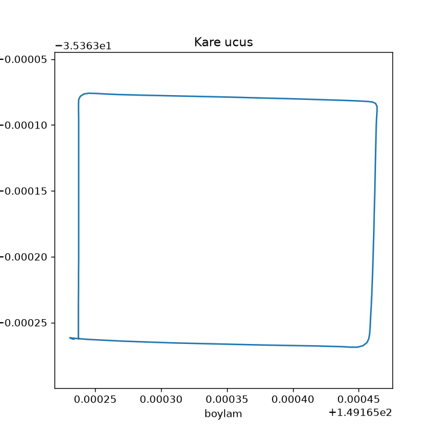
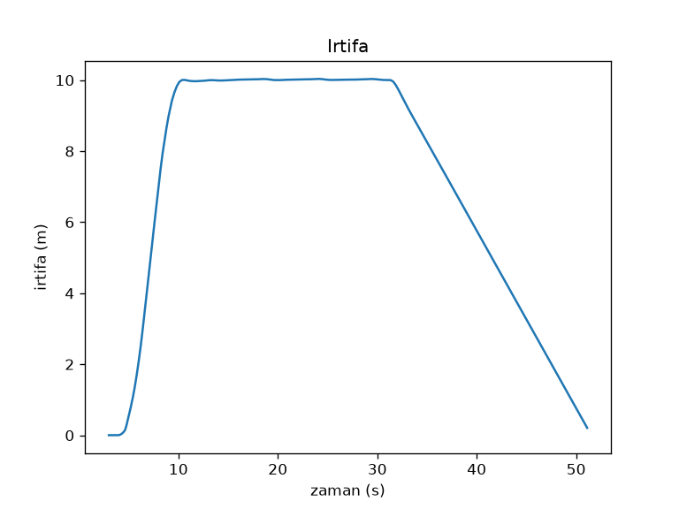

# Proje 1: ArduPilot SITL ile kare görev

## MAVLink nedir?
MAVLink, İHA'lar ile yer istasyonu yazılımları arasında kullanılan hafif bir mesajlaşma protokolüdür. Konum, irtifa, mod gibi veriler ve arm, kalkış, konuma git gibi komutlar küçük mesajlar halinde gönderilir. Bu projede pymavlink kütüphanesiyle Python'dan benzetimdeki İHA'ya MAVLink mesajları gönderip aldım.

## Kod ne yapıyor?
`kare_ucus.py` MAVProxy üzerinden SITL'e bağlanır, GUIDED moda geçer, motorları arm eder ve 10 m'ye kalkar. Sonra 20 m kenarlı karenin 4 köşesine sırayla gider (LOCAL_POSITION_NED ile köşeye 1 m'den yakın olunca sonraki köşeye geçer), LAND moduyla iner. Uçuş boyunca zaman, enlem, boylam ve irtifa `ucus_kaydi.csv` dosyasına yazılır.

## Grafikler

## Karşılaştığım sorun
1. WSL2'de Ubuntu kurulumu `HCS_E_HYPERV_NOT_INSTALLED` hatası verdi. `wsl.exe --install --no-distribution` ve `bcdedit /set hypervisorlaunchtype auto` komutlarından sonra bilgisayarı yeniden başlatınca çözüldü.
2. Betik "Motorlar açık" satırında takılıyordu, çünkü arm komutu GPS/EKF hazır olmadan bir kez gönderiliyordu. Arm komutunu `while not iha.motors_armed()` döngüsünde tekrar göndererek çözdüm.
3. Bağlantı koptuğunda döngüler sonsuza kadar dönüyordu. Her bekleme döngüsüne zaman aşımı ekledim.
